# Watch it move

The gallery is an example app with a page for each thing ginga does: a value toward a target with a spring and a tween, a presence, a list whose items come and go, an accordion, a look, colors, a transition for each value, keyframes, derived values and sequences, a look while hovered, pressed or focused, ways in and out, a shared element, cards that glide to their new places, a drag, and an island. Each page is driven by a few lines that can be copied. It runs on Linux.

```sh
cargo run -p ginga-gpui --example gallery                  # open it
crates/ginga-gpui/examples/gallery/record presence         # record a page
```

Recording runs the page in a virtual display and leaves its frames and a contact sheet in `target/gallery/<page>/`, so a pull request can show a motion beside its trace. It runs on Linux and needs `xvfb-run`, `ffmpeg`, a Vulkan driver (Mesa's, without a GPU) and ImageMagick.

## Contact sheets

Each sheet below is a recording of one page, read left to right and top to bottom, one frame every few dozen milliseconds. The pages not shown here (`layout`, `accordion`, `turn` and `variants`) can be recorded the same way.

| Page | What it shows |
| --- | --- |
| `toward` | A value heads for a target, with a spring and with a tween. |
| `presence` | A toast is shown and hidden, and drawn while it leaves. |
| `ways` | A toast rises in and fades out; titles swap, crossing or one after the other. |
| `shared` | One thing in two places: a tab's mark slides over, a row opens into a card. |
| `list` | Rows arrive and leave a list. |
| `look` | A card declares its look; clicked, it changes size and fades. |
| `transitions` | A card springs to its place while it fades with a tween. |
| `color` | A button changes color; red to blue passes through purple, never green. |
| `gestures` | Buttons answer to the pointer over them, a press and the keyboard focus. |
| `drag` | A card is thrown and springs back inside its tray; a knob rests on a stop. |
| `pulse` | A mark breathes and three dots pulse, through keyframes that repeat. |
| `compose` | A bar's color follows its width; an entrance of three steps. |
| `island` | A dot moves in an island; the grid beside it is not drawn again. |

### `toward`

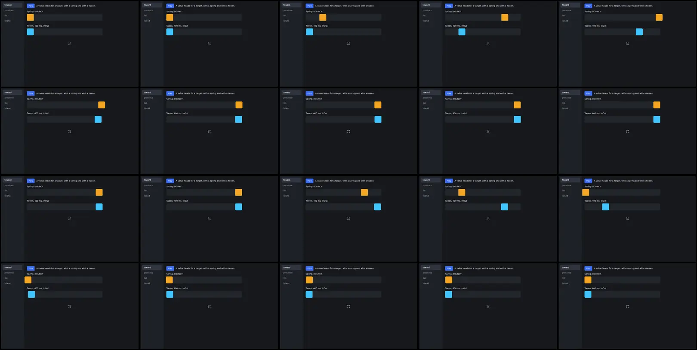

### `presence`

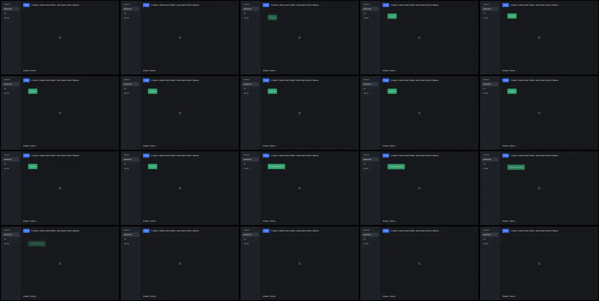

### `ways`

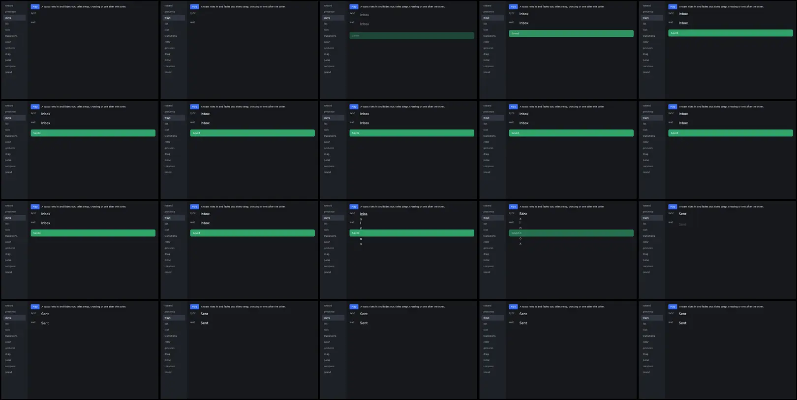

### `shared`

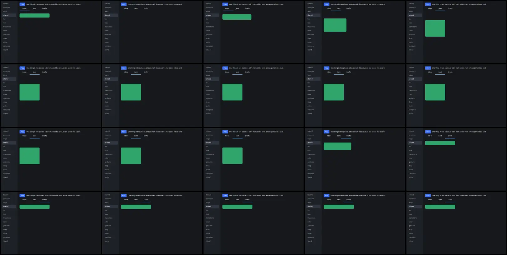

### `list`

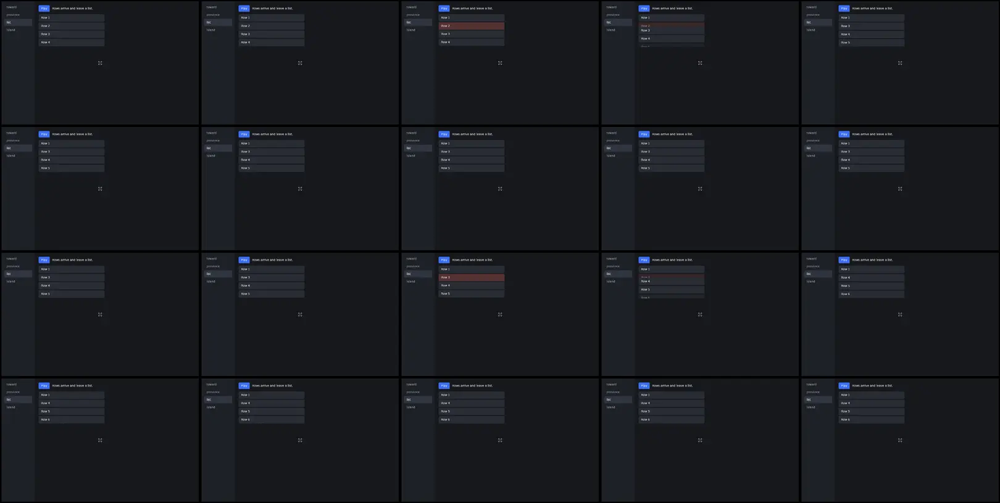

### `look`

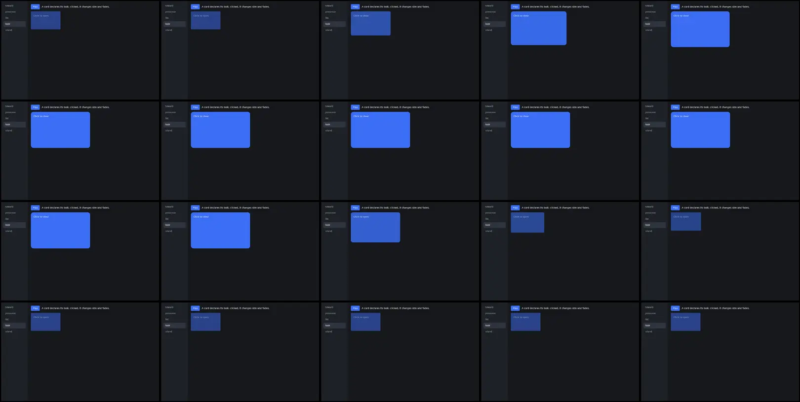

### `transitions`

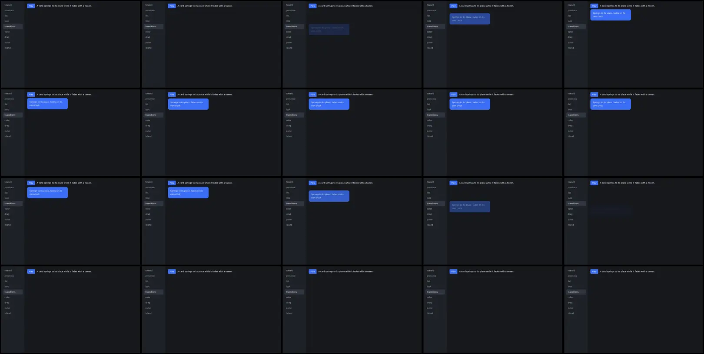

### `color`

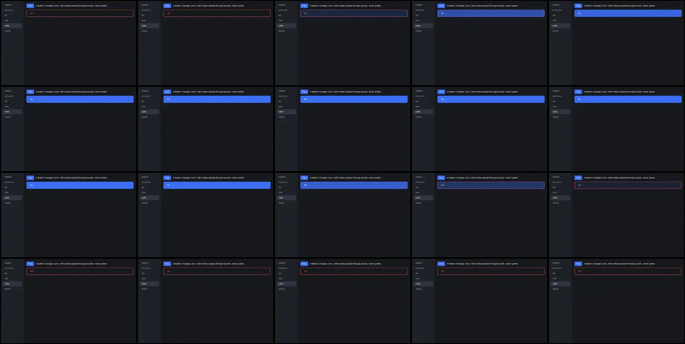

### `gestures`

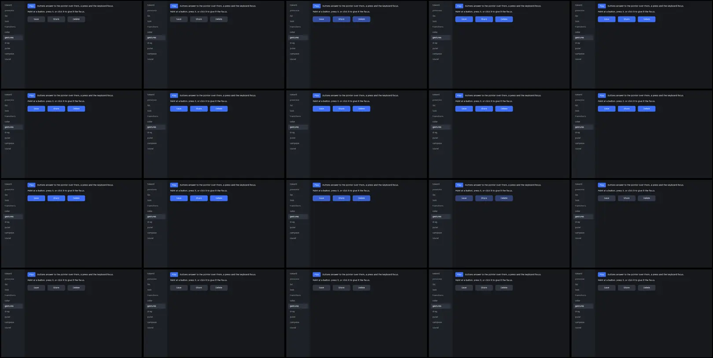

### `drag`

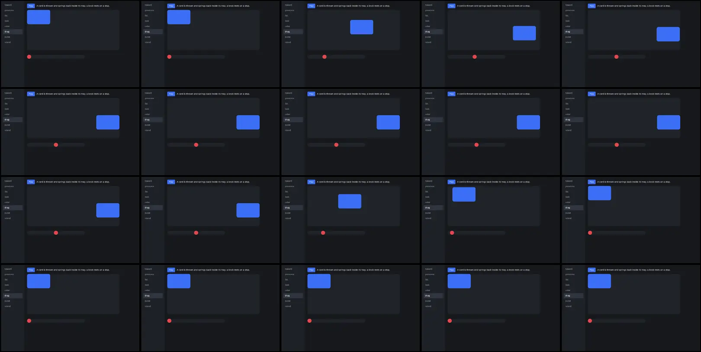

### `pulse`

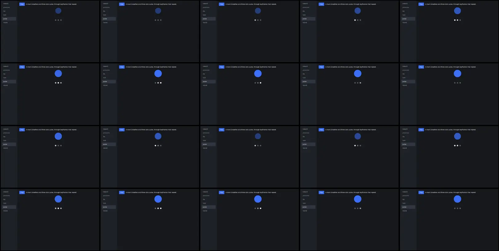

### `compose`

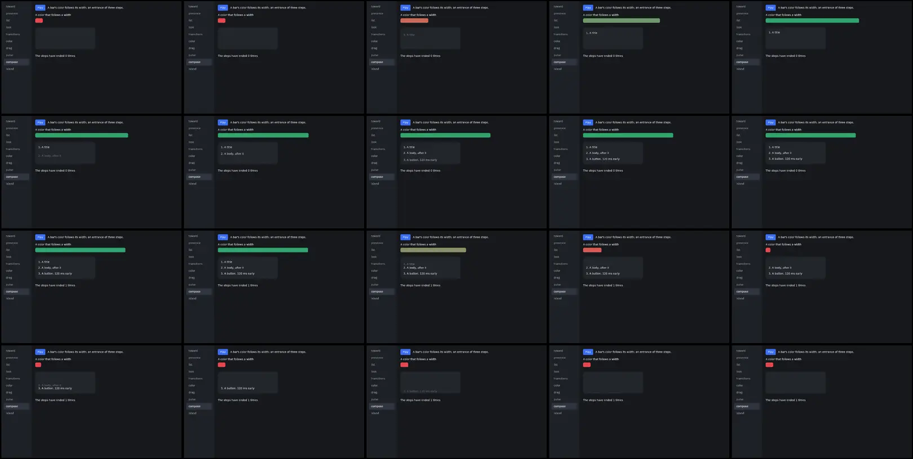

### `island`

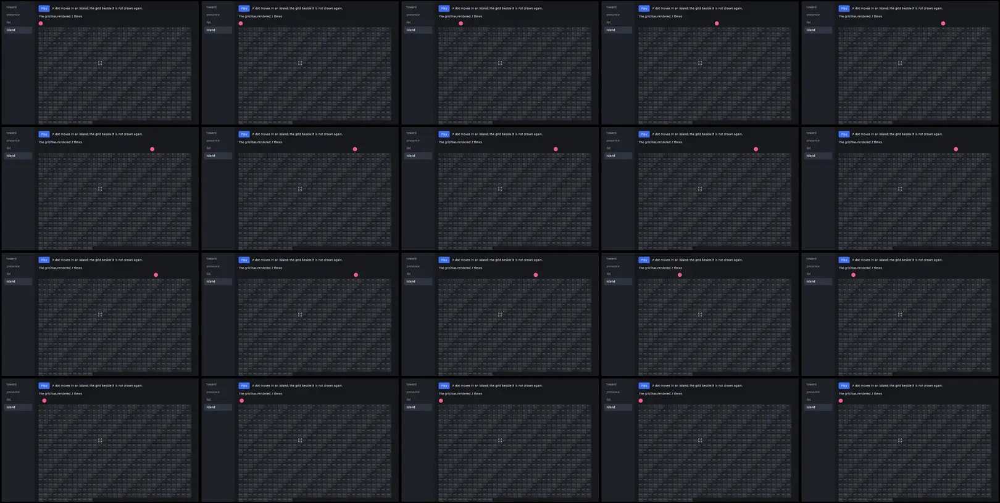
